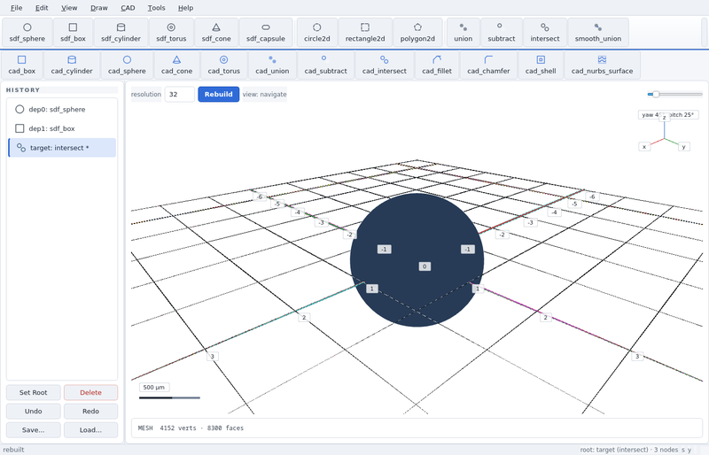
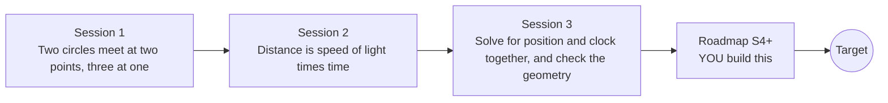

# opengps

[](https://github.com/KrunalPanchal1995/opengps/actions/workflows/ci.yml)   [](https://colab.research.google.com/github/KrunalPanchal1995/opengps/blob/main/sessions/session-01/lesson.ipynb) [](https://krunalpanchal1995.github.io/opengps/)

**Fix a position from satellite distances, and see why relativity matters, in three sessions.**

opengps teaches how GPS finds where you are: trilateration, clock errors, Gauss-Newton and dilution of precision, using only Python and a browser.

- **Start from circles.** Session 1 needs only school geometry: two circles meet at two points, three at one.
- **See it move.** Every session ships a slider app that runs in the browser, with labelled graphs.
- **Know you got it right.** Each session ends with a checkpoint that prints PASS or FAIL against hand calculations and a known true position.
- **Build the missing half.** The repo stops at Session 3 on purpose; the roadmap shows the path to the Target.

[Target](#the-target) · [Who is this for](#who-is-this-for) · [Quick start](#quick-start) · [Sessions](#sessions) · [Roadmap](#roadmap) · [Contribute](#contribute) · [Explainer PDF](docs/explainer.pdf)

> **This repo is incomplete on purpose.** Sessions 1 to 3 are here and fully working. The finished Target below is a preview of what the community can build next. We show you the path, not the code. Sessions 4 and up are yours.

## The Target

A cross-section of the sky shows five toy satellites. The receiver's clock is far off, so the five range circles start too big. Step by step, a Gauss-Newton solver shrinks them until they all meet on the receiver, and it finds the clock error at the same time. On the right, a drift panel shows what happens if the relativity offset of a satellite clock (about +38.5 microseconds per day, computed from the formulas) is left uncorrected: about 11.5 km of range error per day, and a fix that trusts one such clock walks away. Your goal over the coming sessions: build that yourself, then make it more realistic.


*Target: range circles shrink onto the receiver; relativity drift if uncorrected*

- [A Newton step: the idea that Gauss-Newton repeats (video)](promo/media/newton_step.mp4)



*Geometry sandbox: intersecting shapes*

Try it live:

- [Math Visual Studio: linear systems (Atlas S21)](https://krunalpanchal1995.github.io/studio/#atlas?ch=S21&ex=1)
- [Math Visual Studio (root): explore more maths](https://krunalpanchal1995.github.io/studio/)

How the Target was made is shown only as a path in [promo/roadmap.md](promo/roadmap.md).

## Who is this for
**middle school to higher secondary (levels 2-4).** Topic area: Everyday Life and Practical Knowledge.

Prerequisites:

- School geometry: distance between two points and what a circle is.
- Python 3.10 or newer; if `python --version` works, you are ready. PRIMER.md explains the rest.
- Session 2 and 3 use matrices lightly; both are explained from scratch. No prior GitHub or physics background is needed.

New to Python? Read [PRIMER.md](PRIMER.md) first (10 minutes).

## Quick start

No installation knowledge needed. You need [Git](https://git-scm.com/downloads) and [Python 3.10+](https://www.python.org/downloads/) (Windows: tick "Add Python to PATH"). On Mac and Linux type `python3` wherever this page says `python`.

```bash
git clone https://github.com/KrunalPanchal1995/opengps.git
cd opengps
python start.py 1
```

`start.py` creates a private environment, installs what is needed and runs Session 1 with its checkpoint. Next: `python start.py 2`, `python start.py 3`, or `python start.py test` to check everything. Only a checkpoint: `python start.py check 1`.

Four lines turn the idea of Session 2 into a result (they work as they are): Save it as `try.py` and run it with `python start.py run try.py` (this uses the private environment, where NumPy is installed):

```python
import numpy as np
c = 299_792_458.0                      # speed of light, m/s
print(round(c * 1e-6, 1), 'm of range for 1 microsecond')   # -> 299.8
print(round(10 / c * 1e9, 1), 'ns of clock error for 10 m')  # -> 33.4
```

Every session also opens in your browser with sliders (no install): [live apps](https://krunalpanchal1995.github.io/opengps/). Or use the Colab badge above for the notebook.

## Sessions

| # | Session | Model level | Time | Live app |
|---|---|---|---|---|
| 1 | [Two circles meet at two points, three at one](sessions/session-01/README.md) | Level 1: conceptual interactive model | 60 min | [open](https://krunalpanchal1995.github.io/opengps/session-01/) |
| 2 | [Distance is speed of light times time](sessions/session-02/README.md) | Level 2: mathematical engineering model | 75 min | [open](https://krunalpanchal1995.github.io/opengps/session-02/) |
| 3 | [Solve for position and clock together, and check the geometry](sessions/session-03/README.md) | Level 3: simulation and validation | 90 min | [open](https://krunalpanchal1995.github.io/opengps/session-03/) |

Each session follows the same six steps: A real-world problem, B concept and theory, C visual explanation, D interactive simulation, E worked example and experiment, F assessment and design challenge. Each ends with `checkpoint.py`, which prints `PASS` or `FAIL` against reference numbers. Session 3 also contains the real-world mini-project: **Locate a phone from satellite ranges**.

## Architecture



| Folder or file | What is inside |
|---|---|
| `sessions/` | three sessions: README (A-F), `lesson.py`, notebook, live app, exercises, activity sheet, checkpoint |
| `promo/` | the Target: media, live links, and the roadmap (path only) |
| `docs/` | `explainer.tex` and the built `explainer.pdf` |
| `tests/` | runs every lesson and checkpoint headless |
| `start.py` | one command to set up and run anything |
| `QUALITY.md`, `RUBRIC.md` | the quality checklist and the scoring rubric |
| `.github/` | CI, PDF build, Pages deploy, issue and PR templates |

## Roadmap

| Milestone | What you will build | Difficulty |
|---|---|---|
| Session 4: Real orbits instead of fixed toy positions | An orbit propagator that gives each satellite position at any time, replacing the fixed toy positions. | intermediate |
| Session 5: Atmosphere delay | A delay model added to the simulated ranges and a correction in the solver. | intermediate |
| Session 6: Weight the satellites | A weighted Gauss-Newton solver with elevation-dependent noise. | advanced |
| Session 7: Detect and exclude a faulty satellite | A fault detector that flags and removes one bad range. | advanced |
| Session 8: Velocity from Doppler | A second linear solve for the velocity and clock drift of a moving receiver. | advanced |

Full detail with a checkpoint per milestone: [promo/roadmap.md](promo/roadmap.md).

## Contribute
New to GitHub? Read [CONTRIBUTING.md](CONTRIBUTING.md); it starts from zero. Pick an issue labelled `good first issue`. Translations into Hindi, Telugu, Tamil and Malayalam are welcome.

<details>
<summary>Development</summary>

```bash
python start.py test        # runs every lesson and checkpoint
```
Lessons use `# %%` cell markers so they open as notebooks in VS Code. See [QUALITY.md](QUALITY.md) for the standard every session meets.
</details>

## License
MIT. See [LICENSE](LICENSE). Media in `promo/media` is (c) Krunal Panchal, CC BY 4.0.

## Acknowledgments
Part of the [PAN IIT OSS](https://hellofoss.tech-iitb.org/projects) open-source teaching collection, modelled on the structure of [openspline](https://github.com/openspline/openspline). Built on ideas from the Math Visual Studio at https://krunalpanchal1995.github.io/studio/.
