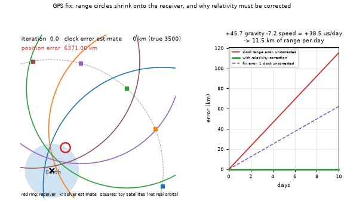

# What you are building toward

A cross-section of the sky shows five toy satellites. The receiver's clock is far off, so the five range circles start too big. Step by step, a Gauss-Newton solver shrinks them until they all meet on the receiver, and it finds the clock error at the same time. On the right, a drift panel shows what happens if the relativity offset of a satellite clock (about +38.5 microseconds per day, computed from the formulas) is left uncorrected: about 11.5 km of range error per day, and a fix that trusts one such clock walks away. Your goal over the coming sessions: build that yourself, then make it more realistic.

*Target: range circles shrink onto the receiver; relativity drift if uncorrected*

These results come from a private reference build. The code is not published; the roadmap shows the path so you can build your own.

Live links:

- [Math Visual Studio: linear systems (Atlas S21)](https://krunalpanchal1995.github.io/studio/#atlas?ch=S21&ex=1)
- [Math Visual Studio (root): explore more maths](https://krunalpanchal1995.github.io/studio/)
