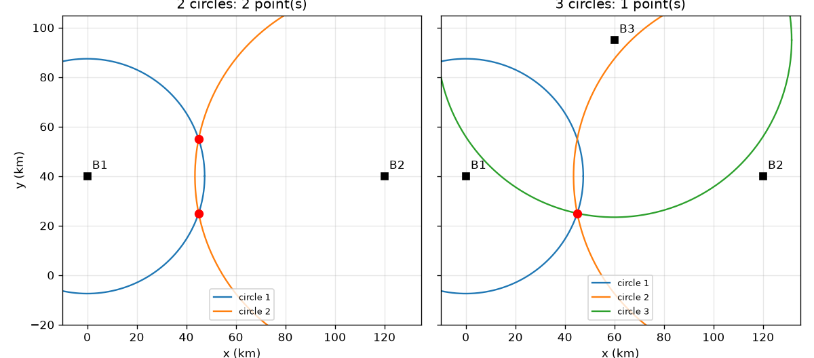
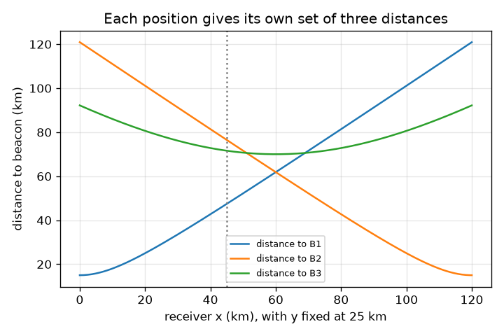

# Session 1: Two circles meet at two points, three at one

*Level 1 (conceptual interactive model) · about 60 minutes · opengps*

> This is a simplified educational model. It is not a validated design tool and must not be used for real structures, electrical installations, vehicles, industrial processes or medical decisions.

**Prerequisites**

- School geometry: distance between two points, and circles.
- You have read PRIMER.md and run `python start.py 1` once.

**Learning objectives.** After this session you can:

- Explain why one distance gives a circle, two give two points and three give one.
- Compute the two points where two circles meet.
- Use a third distance to choose the right point.
- Describe what a small error in one distance does to the answer.

## A. Real-world problem
A phone cannot see where it is. All it can learn is how far away some known points are. If you know you are 47 km from a tower, you could be anywhere on a circle around it. How many towers do you need to say exactly where you are? And in the real world the 'towers' are satellites in 3D: how many are needed there? (Educational model on a flat toy map, in kilometres.)

## B. Concept and theory
A distance r from a known point B puts you on a circle of radius r around B. Two circles with centres c1 and c2 (distance d apart) meet where you walk a = (d^2 + r1^2 - r2^2) / (2 d) from c1 towards c2 and then go h = sqrt(r1^2 - a^2) sideways, left or right. That gives two points, mirror images of each other across the line joining the centres. A third circle, whose centre is not on that line, passes through only one of them, so the position is unique. In 3D the circles become spheres: three spheres still meet at two points (a mirror pair), so a fourth distance is needed to choose; in real GPS the fourth satellite is also needed for another reason, the receiver clock, which Session 3 explains.

| Symbol | Meaning | Unit |
|---|---|---|
| B1, B2, B3 | known beacon positions (toy map) | km |
| r1, r2, r3 | measured distances to the beacons | km |
| d | distance between beacons 1 and 2 | km |
| a, h | distance along and across the line joining beacons 1 and 2 | km |
| miss | how far a candidate is from fitting circle 3 | km |

**Assumptions**

- The map is flat and the distances are exact (except where we add an error on purpose).
- The three beacons are not in a straight line.
- Beacon positions are illustrative, not real transmitters.

$$ a=\frac{d^2+r_1^2-r_2^2}{2d},\qquad h=\sqrt{r_1^2-a^2} $$

$$ \mathbf p=\mathbf c_1+a\,\mathbf u\ \pm\ h\,\mathbf n,\qquad \mathbf u=\frac{\mathbf c_2-\mathbf c_1}{d},\ \mathbf n\perp\mathbf u $$

$$ \text{miss}=\left|\,|\mathbf p-\mathbf B_3|-r_3\,\right| $$

## C. Visual explanation
The first figure shows the toy map with the receiver at (45, 25) km. With two circles (left) they cross at two red points, (45, 25) and (45, 55) km, mirror images across the line joining beacons 1 and 2. With three circles (right) only one point is on all of them. The second figure plots the three distances as the receiver moves along x with y = 25 km: distances to B1 and B2 are equal at x = 60 km, halfway between them.

*Left: two circles meet at two points. Right: a third circle leaves one point (toy map, km).*

*Distance to each beacon as the receiver moves along x at y = 25 km.*

## D. Interactive simulation
Run the lesson (`python start.py 1`), then open the live app: [Session 1: circles that meet](https://krunalpanchal1995.github.io/opengps/session-01/) (or `app.html` in this folder). Move the receiver, then add circles one at a time and watch the candidates appear and disappear. Use the error slider to give beacon 3 a wrong distance and see the circles stop meeting at one point. Switch to the graph view to see the three distances.

**Challenge.** Place the receiver at (80, 50) km, show all three circles and keep the range error at zero, so the fix is exact.

## E. Worked example and experiment
**Problem.** Beacons B1 = (0, 40), B2 = (120, 40), B3 = (60, 95) km. A receiver measures d1 = 47.43 km, d2 = 76.49 km and d3 = 71.59 km. Where is it?

1. d = distance between B1 and B2 = 120 km. Squares of the ranges: r1^2 = 2250 and r2^2 = 5850 km^2.
2. a = (120^2 + 2250 - 5850) / (2 x 120) = 10800 / 240 = 45 km.
3. h = sqrt(2250 - 45^2) = sqrt(2250 - 2025) = sqrt(225) = 15 km.
4. The centres lie on the line y = 40, so the two candidates are (45, 40 - 15) = (45, 25) and (45, 40 + 15) = (45, 55) km.
5. Distance from (45, 55) to B3 is sqrt(15^2 + 40^2) = 42.72 km but r3 = 71.59 km, a miss of 28.87 km. Distance from (45, 25) to B3 is sqrt(15^2 + 70^2) = 71.59 km, a miss of zero.

**Answer.** The receiver is at (45, 25) km; the other candidate (45, 55) km misses circle 3 by 28.87 km.

**Experiment.** Mark three points on a big sheet of paper or a playground (say 3 m, 4 m and 5 m apart), measure the distance from a friend to each with a rope or a measuring tape, then use a string compass to draw the three circles to scale. The circles will not meet at exactly one point: tape stretches, the friend is not a point, and the paper is not flat ground. The little triangle left between the circles is the model-versus-reality gap, and it is the picture of the 'misfit' in the checkpoint.

## F. Assessment and design challenge
**Question type A: Conceptual.** Why do two circles give two points and not one? What would a single extra circle have to avoid to be useful?

Hint

Think of the line joining the two centres and a mirror placed on it.

Step-by-step solution

If a point is at distance r1 from c1 and r2 from c2, its mirror image across the line through c1 and c2 has exactly the same two distances, so both are valid answers. A third circle helps only if its centre is NOT on that line: otherwise the mirror image is at the same distance from it too and the ambiguity remains.

**Question type B: Numerical.** A receiver is sqrt(4500) = 67.08 km from both B1 = (0, 40) and B2 = (120, 40). Find the two candidate positions. Then use B3 = (60, 95) with r3 = 25 km to choose.

Hint

d = 120 km, so a = d/2 when r1 = r2. Then h = sqrt(r1^2 - a^2).

Step-by-step solution

a = (14400 + 4500 - 4500) / 240 = 60 km and h = sqrt(4500 - 3600) = sqrt(900) = 30 km, so the candidates are (60, 70) and (60, 10) km. Distance from (60, 70) to B3 is 25 km, which matches r3; from (60, 10) it is 85 km. The fix is (60, 70) km. Sanity check: 60 is halfway between x = 0 and x = 120, as it must be for equal distances.

**Question type C: Graph and simulation interpretation.** In the distance graph (receiver moving along x at y = 25 km), where do the curves for B1 and B2 cross, and what is the distance there?

Hint

They cross where the two distances are equal. B1 and B2 sit at x = 0 and x = 120.

Step-by-step solution

They cross at x = 60 km, halfway between the beacons, where each distance is sqrt(60^2 + 15^2) = sqrt(3825) = 61.85 km. Left of 60 the receiver is closer to B1, right of 60 closer to B2.

**Question type D: Design and optimisation challenge.** Design: you can put the third beacon at (60, 40), (60, 95) or (130, 40) km, with B1 = (0, 40) and B2 = (120, 40). Which choices let a receiver at (45, 25) tell itself from its mirror image (45, 55)? Explain the trade-off.

Hint

The mirror line is y = 40. A beacon on that line is equally far from both candidates.

Step-by-step solution

(60, 40) and (130, 40) lie on the line y = 40 so they are equally far from (45, 25) and (45, 55): they cannot decide. Only (60, 95) works (distance 71.59 km versus 42.72 km). A beacon far off the line gives a large difference between the two candidates, so the choice is robust to ranging errors: the gap here is 28.87 km. A beacon only slightly off the line would give a tiny difference and an error of a few hundred metres could pick the wrong point.

Score yourself with [RUBRIC.md](../../RUBRIC.md). Print the [activity sheet](activity_sheet.md) to work on paper.

## Common misconceptions
| Common misconception | What is actually true |
|---|---|
| Two distances are enough to fix a position. | Two circles meet at two points. You need a third distance (circle) whose centre is off the line of the first two, to choose. |
| Circles meet only if the ranges are exact. | Circles meet if the ranges are consistent. A small error in one range leaves a small gap or overlap (the misfit), and the answer is then only approximate. |
| A distance tells you the direction to the beacon. | A distance only puts you on a circle; the direction is not known. Many positions have the same distance. |

## Glossary
- **trilateration**: finding a position from distances to known points (not angles)
- **beacon**: a transmitter at a known position
- **range**: the distance between receiver and beacon
- **misfit**: how far a candidate position is from matching a measured distance
- **mirror image**: the point on the other side of a line at the same distances from both ends of it

## Finish
1. Do the three coding tasks in [exercises.md](exercises.md).
2. Run `python start.py 1` again after your changes. It ends with the checkpoint; when it prints `PASS`, you are done. (Checkpoint only: `python start.py check 1`.)

Next: [Session 2](../session-02/README.md)
