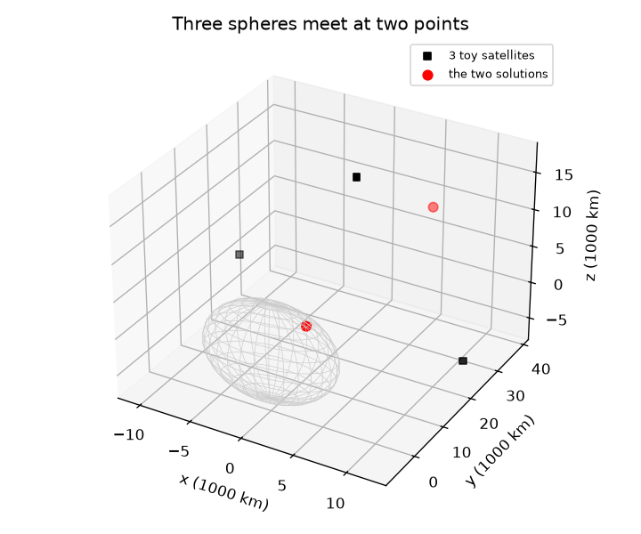
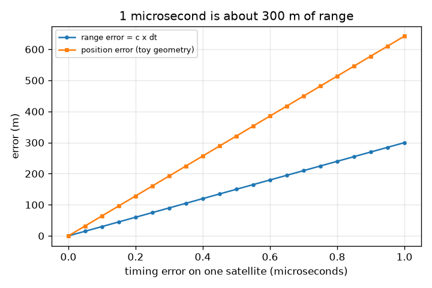

# Session 2: Distance is speed of light times time

*Level 2 (mathematical engineering model) · about 75 minutes · opengps*

> This is a simplified educational model. It is not a validated design tool and must not be used for real structures, electrical installations, vehicles, industrial processes or medical decisions.

**Prerequisites**

- Session 1: circles and trilateration.
- Solving two linear equations in two unknowns.

**Learning objectives.** After this session you can:

- Compute a pseudorange from a travel time, and a timing error from a range error.
- Linearise the sphere equations by subtracting one from the others and solve the system.
- Explain why three spheres leave two points in 3D and what a fourth range does.
- Solve a design problem: how accurate must a clock be for a given position accuracy?

## A. Real-world problem
A GPS satellite sends a radio signal stamped with the time it left. Your phone notes when it arrives. The distance is the speed of light times the travel time, and light covers 300 m in a single microsecond. So how good must a clock be to locate you within 10 m? And how do we solve for a position from distances without solving quadratic equations? (Educational model with toy satellite positions, not real orbits; Earth is a sphere.)

## B. Concept and theory
A pseudorange is c times the measured travel time. It is called pseudo because the clocks are not perfect, so it is not exactly the true distance. Each satellite i at position s_i gives |x - s_i| = r_i, a sphere (circle in 2D) around s_i. Squares make this quadratic, but subtracting the equation of satellite 1 from satellite i cancels the |x|^2 term and leaves a plane (line in 2D): 2 (s_i - s_1) . x = |s_i|^2 - |s_1|^2 - r_i^2 + r_1^2. In 2D, three satellites give two such lines and a unique point. In 3D, three satellites give only two planes (two equations, three unknowns): their line of intersection cuts the first sphere in two points, so the answer is ambiguous; a fourth satellite adds a third plane and fixes it. A timing error dt is a range error c dt, and the position error is that range error multiplied by a geometry-dependent amplification.

| Symbol | Meaning | Unit |
|---|---|---|
| c | speed of light in vacuum, 299,792,458 | m/s |
| t | signal travel time | s |
| r = c t | pseudorange (distance as the clock sees it) | m |
| s_i | position of satellite i | m |
| x | receiver position | m |
| dt | timing error | s |

**Assumptions**

- Signal speed is c (no atmosphere delay).
- Receiver clock is perfect (Session 3 removes this).
- Satellite positions are toy values 26,560 km from the Earth's centre, not real orbits.
- Earth is a sphere of radius 6371 km.

$$ r_i=c\,t_i,\qquad \Delta r=c\,\Delta t $$

$$ \|\mathbf x-\mathbf s_i\|^2=r_i^2\ \Longrightarrow\ 2(\mathbf s_i-\mathbf s_1)\cdot\mathbf x=\|\mathbf s_i\|^2-\|\mathbf s_1\|^2-r_i^2+r_1^2 $$

$$ A\mathbf x=\mathbf b,\qquad A=2\begin{pmatrix}(\mathbf s_2-\mathbf s_1)^{\mathsf T}\\ \vdots\\ (\mathbf s_n-\mathbf s_1)^{\mathsf T}\end{pmatrix} $$

$$ \Delta t_{\max}=\frac{\Delta r_{\max}}{c} $$

## C. Visual explanation
The first figure plots a timing error against the error it causes: the range error is a straight line of slope 299.8 m per microsecond, and the position error in the toy 3D geometry is a steeper straight line (about 642 m per microsecond), because the geometry amplifies the range error by about 2.1. The second figure shows three spheres from three toy satellites meeting at two red points: one on the Earth's surface, and one far out in space at 39,789 km from the Earth's centre. A real receiver can reject the far one, but the fourth range is still needed for the clock, as Session 3 shows.

*Three toy satellites: the spheres meet at two points, one on the Earth, one far out in space.*

*Range error (c x dt) and the larger position error it causes in the toy geometry.*

## D. Interactive simulation
Run the lesson (`python start.py 2`), then open the live app: [Session 2: a small clock error, a big position error](https://krunalpanchal1995.github.io/opengps/session-02/) (or `app.html` in this folder). Move the timing-error slider and watch the range error (c x dt) and the fix error. Then change the satellite spread: satellites close together amplify the same clock error into a much bigger position error.

**Challenge.** Keep the fix error below 100 m although satellite 1 has a clock error of at least 0.2 microseconds.

## E. Worked example and experiment
**Problem.** Three ground beacons B1 = (0, 40), B2 = (120, 40), B3 = (60, 95) km send timed signals to a receiver. It records travel times 158.22, 255.12 and 238.80 microseconds. Find the position by subtracting equations.

1. Ranges r = c t: 158.22 us gives 47.43 km, 255.12 us gives 76.49 km, 238.80 us gives 71.59 km. So r1^2 = 2250, r2^2 = 5850, r3^2 = 5125 km^2.
2. Subtract equation 1 from equation 2: 2 (120, 0) . (x, y) = (14400 + 1600) - 1600 - 5850 + 2250, so 240 x = 10800 and x = 45 km.
3. Subtract equation 1 from equation 3: 2 (60, 55) . (x, y) = (3600 + 9025) - 1600 - 5125 + 2250, so 120 x + 110 y = 8150.
4. Put x = 45: 5400 + 110 y = 8150, so y = 25 km.
5. Check with equation 1: sqrt(45^2 + (25 - 40)^2) = sqrt(2250) = 47.43 km, which matches.

**Answer.** The receiver is at (45, 25) km, the same as in Session 1. The clock accuracy for a 10 m range error is 10 / c = 33.4 nanoseconds.

**Experiment.** Measure the speed of sound with a clap and an echo: stand 50 m from a flat wall, clap, and time the echo with a phone stopwatch (about 0.29 s). Distance = speed x time gives about 343 m/s at 20 degrees C. Your stopwatch error of 0.1 s is a distance error of about 34 m, the same lesson as GPS: speed times time error is distance error. For radio, c is a million times bigger, so the clock must be a million times better.

## F. Assessment and design challenge
**Question type A: Conceptual.** Why does subtracting one sphere equation from another make the problem linear, and what do the new equations represent geometrically?

Hint

Write |x - s|^2 = |x|^2 - 2 s.x + |s|^2 and look at the |x|^2 terms.

Step-by-step solution

Expanding |x - s_i|^2 = r_i^2 gives |x|^2 - 2 s_i.x + |s_i|^2 = r_i^2. The term |x|^2 is the same in every equation, so it cancels when we subtract two of them, leaving something linear in x. Each such equation is a plane (line in 2D): the plane containing all points that are on both spheres, which is where the two spheres cross.

**Question type B: Numerical.** A satellite clock is wrong by 50 nanoseconds. What range error is that? Is it small compared with a 10 m accuracy goal?

Hint

range error = c x timing error; 50 ns = 50e-9 s.

Step-by-step solution

299,792,458 m/s x 50e-9 s = 14.99 m, about 15 m. That alone already exceeds the 10 m goal, before any amplification by geometry. Sanity check: 1 microsecond is 300 m, so 50 ns = 1/20 of that = 15 m.

**Question type C: Graph and simulation interpretation.** In the timing-error figure the position-error line is steeper than the range-error line. What does the ratio of slopes tell you, and what could make it larger?

Hint

Slope = metres of error per microsecond of timing error.

Step-by-step solution

The slopes are about 642 m per microsecond (position) and 299.8 m per microsecond (range): the ratio, about 2.1, is the amplification of range error into position error by this geometry. Satellites bunched close together in the sky make it larger (the app shows about 11 at its narrowest 20 degree spread, and below 1 at 85 degrees); satellites spread widely make it smaller.

**Question type D: Design and optimisation challenge.** Design: you need the position error below 10 m, and in the toy geometry of the figure the amplification is about 2.14. How accurate (in nanoseconds) must the clock error on one range be? What steadiness over one day (a fraction) does that need?

Hint

Position error = 642.4 m per microsecond of timing error. Divide the allowed error by it. Then divide by the number of seconds in a day, 86,400.

Step-by-step solution

10 m / 642.4 m per microsecond = 0.01557 microseconds = 15.6 ns. Holding 15.6 ns over one day needs a fractional steadiness of 15.6e-9 / 86400 = 1.8e-13. (If the geometry did not amplify, 10 m would need 33.4 ns and 3.9e-13.) This is why GPS satellites carry atomic clocks, and a phone's cheap clock is not good enough: Session 3 solves for the phone's clock error instead. Trade-off: better clocks cost more; better geometry costs nothing but depends on where the satellites are.

Score yourself with [RUBRIC.md](../../RUBRIC.md). Print the [activity sheet](activity_sheet.md) to work on paper.

## Common misconceptions
| Common misconception | What is actually true |
|---|---|
| A distance error of 1 m needs a clock error of about 1 ms. | Light is very fast: 1 m is only about 3.3 nanoseconds. A millisecond is about 300 km. |
| Linearising by subtraction is an approximation. | Here it is exact: the quadratic term cancels completely. (Linearising by a Taylor series, as in Session 3, is an approximation.) |
| Three satellites always fix a 3D position. | With exact ranges three spheres give two points. A fourth range (or extra knowledge, such as being on the Earth's surface) chooses between them. |

## Glossary
- **pseudorange**: c times the measured travel time; the distance as the receiver's clock sees it
- **linearise**: turn a quadratic equation into a linear one
- **nanosecond**: one billionth of a second; light travels about 30 cm in it
- **amplification**: how much a range error is magnified into a position error by the geometry
- **toy satellite**: a satellite position chosen for teaching, not from a real orbit

## Finish
1. Do the three coding tasks in [exercises.md](exercises.md).
2. Run `python start.py 2` again after your changes. It ends with the checkpoint; when it prints `PASS`, you are done. (Checkpoint only: `python start.py check 2`.)

Next: [Session 3](../session-03/README.md)
