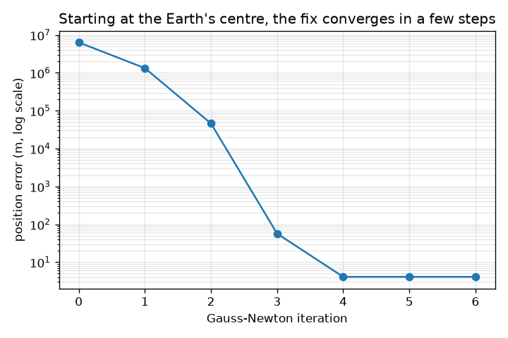
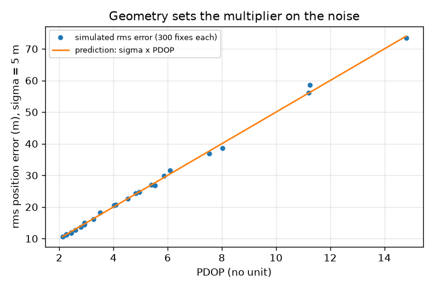
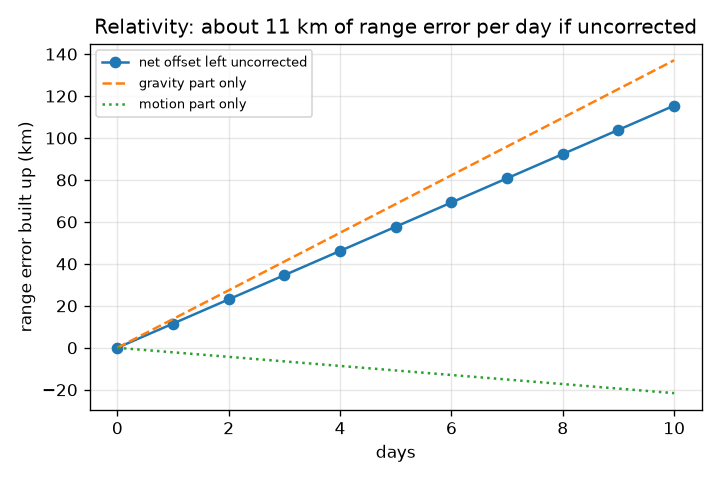

# Session 3: Solve for position and clock together, and check the geometry

*Level 3 (simulation and validation) · about 90 minutes · opengps*

> This is a simplified educational model. It is not a validated design tool and must not be used for real structures, electrical installations, vehicles, industrial processes or medical decisions.

**Prerequisites**

- Session 2: pseudoranges and the linear solve.
- Matrices: multiplication, transpose and inverse (helpful; explained in Section B).

**Learning objectives.** After this session you can:

- Set up the pseudorange model with an unknown receiver clock bias and solve it by Gauss-Newton.
- Compute dilution of precision (DOP) from the geometry and use it to predict the position error.
- Validate the solver against a known true position with noise, and show that it matches sigma x PDOP.
- Compute the special and general relativity offsets of a satellite clock from their formulas, and explain why they matter.

## A. Real-world problem
Your phone's clock is cheap: it can be off by milliseconds, and each millisecond is 300 km of range. So the phone treats its clock error as one more unknown, which is why GPS needs at least four satellites for a 3D fix. The ranges also have noise, and some satellite layouts give much better results than others. Finally, the satellites carry atomic clocks that run at a slightly different rate from clocks on the ground, because of relativity: how big is that, and what happens if nobody corrects it? (Educational model: toy satellite positions, not real orbits; no atmosphere, no real ephemeris; not a navigation tool.)

## B. Concept and theory
The model is rho_i = |s_i - x| + b + noise_i, where b is the receiver clock error times c (in metres). The unknowns are z = (x, y, z, b). Gauss-Newton guesses z, predicts every rho_i, and solves the linearised mismatch G dz = residual in the least-squares sense, where row i of G is [ -(s_i - x)/|s_i - x|, 1 ]. Repeating this converges in a few steps even from the Earth's centre. With equal noise sigma on every range, the covariance of the estimate is sigma^2 (G^T G)^-1; its diagonal gives the dilution of precision: PDOP is the factor by which the noise is multiplied in 3D position, so the expected rms position error is sigma x PDOP. A satellite clock is affected by relativity in two opposite ways. General relativity: higher in the gravity well the clock runs faster, by the fraction GM/c^2 (1/R_earth - 1/r_sat). Special relativity: a moving clock runs slower, by v^2/(2 c^2), with v^2 = GM/r_sat for a circular orbit. These are well-known approximate results; we compute them below with a spherical Earth and ignore smaller effects (Earth's rotation, orbit eccentricity).

| Symbol | Meaning | Unit |
|---|---|---|
| x | receiver position | m |
| b = c x (clock error) | receiver clock bias as a distance | m |
| rho_i | measured pseudorange to satellite i | m |
| sigma | range noise (standard deviation) | m |
| G | geometry matrix, rows [-unit vector to satellite, 1] | no unit |
| PDOP, HDOP, VDOP, TDOP | dilution of precision (3D, horizontal, vertical, time) | no unit |
| GM | Earth's gravitational parameter 3.986004418e14 | m^3/s^2 |
| R_earth, r_sat | 6,371,000 and 26,560,000 (toy) | m |

**Assumptions**

- Toy satellite positions, spherical Earth, no atmosphere.
- Noise is independent Gaussian with the same sigma for every satellite.
- Satellite clock errors are zero unless we add them on purpose.
- Relativity: circular orbit, spherical non-rotating Earth; numbers are approximate.

$$ \rho_i=\|\mathbf s_i-\mathbf x\|+b+\varepsilon_i $$

$$ G\,\delta\mathbf z=\boldsymbol\rho-\hat{\boldsymbol\rho}(\mathbf z),\qquad G_i=\left[-\frac{(\mathbf s_i-\mathbf x)^{\mathsf T}}{\|\mathbf s_i-\mathbf x\|},\ 1\right] $$

$$ Q=(G^{\mathsf T}G)^{-1},\qquad \mathrm{PDOP}=\sqrt{Q_{11}+Q_{22}+Q_{33}},\qquad \text{rms error}\approx\sigma\,\mathrm{PDOP} $$

$$ \frac{\Delta f}{f}\Big|_{\rm gravity}=\frac{GM}{c^2}\left(\frac{1}{R_E}-\frac{1}{r_s}\right),\qquad \frac{\Delta f}{f}\Big|_{\rm motion}=-\frac{v^2}{2c^2}=-\frac{GM}{2c^2 r_s} $$

## C. Visual explanation
The first figure shows the error of the fix at each Gauss-Newton iteration, starting at the Earth's centre: it falls from thousands of km to millimetres in six steps. The second figure compares the simulated rms error for 25 random sky layouts with the line sigma x PDOP: they agree, so DOP really predicts the effect of geometry. The third figure shows the range error that builds up if the relativity offset is left uncorrected: a straight line of about 11.5 km per day, made of a gravity part (about +13.7 km per day) and a smaller opposite speed part.

*Error of the fix at each Gauss-Newton iteration, starting from the Earth's centre.*

*Simulated rms error against PDOP for random toy skies: the dots follow sigma x PDOP.*

*Range error from the relativity offsets if left uncorrected, per day.*

## D. Interactive simulation
Run the lesson (`python start.py 3`), then open the live app: [Session 3: geometry, DOP and relativity](https://krunalpanchal1995.github.io/opengps/session-03/) (or `app.html` in this folder). Change the number of satellites and the spread of the sky and watch the PDOP and the expected error. Then open the relativity view and slide the number of days without correction.

**Challenge.** Reach a PDOP below 2.7 using at most five satellites.

## E. Worked example and experiment
**Problem.** Compute the relativity offsets of a GPS satellite clock at r = 26,560 km from the Earth's centre (ground at 6371 km), and the range error if left uncorrected for one day.

1. GM/c^2 = 3.986004e14 / 8.98755e16 = 4.4350e-3 m. 1/R_E = 1.5696e-7 per m and 1/r_s = 3.7651e-8 per m, so the difference is 1.1931e-7 per m.
2. Gravity: fractional rate = 4.4350e-3 x 1.1931e-7 = 5.2915e-10. Per day: 5.2915e-10 x 86400 s = 4.572e-5 s = +45.7 microseconds per day (the clock runs fast).
3. Motion: v^2 = GM / r_s = 1.5008e7 m^2/s^2 (v = 3874 m/s). Fraction = v^2 / (2 c^2) = 8.349e-11. Per day: 7.21 microseconds, with a minus sign (the clock runs slow).
4. Net = 45.7 - 7.2 = +38.5 microseconds per day (the clock runs fast).
5. Range: c x 38.5e-6 s = 11.5 km per day. After 10 days: 115 km.

**Answer.** About +45.7 (gravity) and -7.2 (motion), net +38.5 microseconds per day; left uncorrected, about 11.5 km of range per day. These match the well-known approximate values (about 45, 7 and 38 microseconds per day). Even if every satellite clock shared the error, the receiver bias absorbs it (the checkpoint shows this); but the error would still spoil time transfer, and any clock that differs from the others (one wrong clock) moves the fix, by 22.0 km in our four-satellite example after one day.

**Experiment.** You cannot measure this at home, but you can test the idea of a clock rate error: time a pendulum or a stopwatch app against an online time service for ten minutes and compute the fractional rate error and the range error it would cause (rate error x c x time). A phone clock drifts by roughly milliseconds, which is why the receiver treats its clock error as unknown. Model versus reality: real satellite clocks are also adjusted before launch, and the ground control sends corrections; our model has none of those.

## Real-world application and mini-project: Locate a phone from satellite ranges
A phone tracks eight toy satellites but its chip can use only four at a time. The synthetic pseudoranges are made in code with `pseudoranges(sats, rec, bias, 5.0, np.random.default_rng(2024))` using the receiver at 19 N, 73 E, `GOOD_SKY` satellites and a clock bias of 0.35 ms. Find the best four satellites (lowest PDOP) out of the 70 possible sets, fix the phone with them using `gauss_newton`, and compare with the first four satellites.

**Deliverable:** A script that prints, for the best set and for the first four satellites, the PDOP, the position error in metres against the known true position, and the estimated clock bias in milliseconds, and says which satellites were chosen.

**Success looks like:** The best set is satellites 4, 5, 6 and 7 with PDOP 2.55 (the first four give 3.48); the estimated clock bias is 0.350 ms; and the position error is below 38 m, which is 3 x sigma x PDOP for sigma = 5 m.

## F. Assessment and design challenge
**Question type A: Conceptual.** Why does a 3D GPS fix need four satellites even when the satellites are known exactly and the Earth's radius is known?

Hint

Count the unknowns in z, and ask what the receiver clock does to every pseudorange.

Step-by-step solution

There are four unknowns: x, y, z and the receiver clock bias b. The cheap receiver clock adds the same unknown distance b to every pseudorange, so each satellite gives one equation and four equations are needed. (Earth-radius knowledge could replace one satellite but only if the receiver is known to be on the surface.)

**Question type B: Numerical.** Range noise has sigma = 3 m and the satellites give PDOP = 3.48. What rms 3D position error do you expect? And with PDOP = 1.89?

Hint

rms error is about sigma x PDOP.

Step-by-step solution

3 x 3.48 = 10.4 m for PDOP 3.48 and 3 x 1.89 = 5.7 m for PDOP 1.89. Sanity check: the error is a few times the noise, and better geometry (lower PDOP) reduces it.

**Question type C: Graph and simulation interpretation.** In the DOP-validation figure the dots lie on the line sigma x PDOP. What does that say about the simulation and about DOP? What would it mean if the dots were far above the line?

Hint

The line is the theory; the dots are measured rms errors from many noisy fixes.

Step-by-step solution

The simulation agrees with the theory, so DOP correctly predicts how much geometry multiplies range noise. Dots far above the line would mean something else is adding error (an unmodelled bias, a faulty satellite, or Gauss-Newton failing to converge), so the fix is worse than the geometry alone explains.

**Question type D: Design and optimisation challenge.** Design: a phone has eight toy satellites in view but can use only four. There are 70 choices. Which four would you use, and why? What does the worst four do?

Hint

Compute PDOP for every set of four with `dop` and compare. Do not forget to inspect the worst set.

Step-by-step solution

The best set is satellites 4, 5, 6 and 7 (1-indexed), with PDOP 2.55, versus 3.48 for the first four. The worst set (satellites 2, 3, 4, 5) has PDOP 363.7: a tiny noise is multiplied by hundreds and Gauss-Newton may even diverge. Choose by PDOP; the trade-off is that the best geometry may include low satellites that suffer more atmosphere delay in the real world, which this model leaves out.

Score yourself with [RUBRIC.md](../../RUBRIC.md). Print the [activity sheet](activity_sheet.md) to work on paper.

## Common misconceptions
| Common misconception | What is actually true |
|---|---|
| More satellites always give a better fix. | More satellites help only if they improve the geometry or average down noise; they cannot fix a bad common error, and a faulty one can hurt. |
| A low DOP means the fix is accurate. | DOP is only the multiplier of the range noise. Accuracy is sigma x DOP, so a good geometry with large noise is still poor. |
| Relativity matters because GPS satellites move fast. | Two effects act in opposite directions: weaker gravity speeds the clock up (+45.7 microseconds per day) and motion slows it down (-7.2); the gravity effect is larger, so the net is a speed-up of 38.5. |
| An uncorrected clock offset always moves the fix by 11 km per day. | 11.5 km per day is the range error. A shared offset in all satellite clocks is absorbed into the receiver bias; one mismatched clock moves the fix. |

## Glossary
- **Gauss-Newton**: repeat: linearise the model, solve for a correction by least squares, update
- **Jacobian**: the matrix of partial derivatives of the predicted ranges with respect to the unknowns (here G)
- **clock bias**: the receiver clock error, written as a distance b = c x error
- **DOP**: dilution of precision: how the satellite geometry multiplies range noise
- **residual**: measured minus predicted range
- **time dilation**: a moving clock ticks slower; weaker gravity makes a clock tick faster

## Finish
1. Do the three coding tasks in [exercises.md](exercises.md).
2. Run `python start.py 3` again after your changes. It ends with the checkpoint; when it prints `PASS`, you are done. (Checkpoint only: `python start.py check 3`.)

Next: the [roadmap](../../promo/roadmap.md). Session 4 is yours to build.
